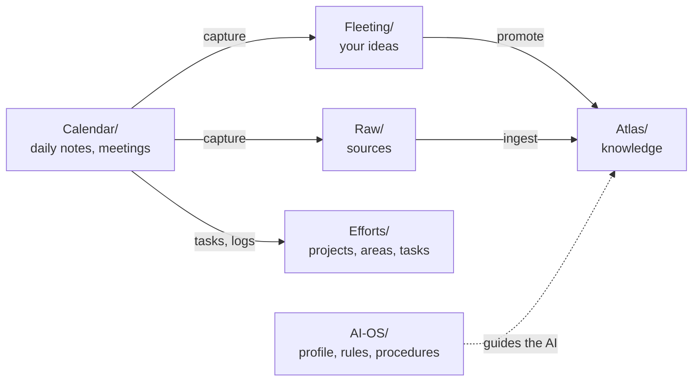

# Munin-Template-Vault

> **⚠️ Work in progress.** The template is under active development: folders, templates and conventions still change between releases. Each release says what changed and what you do in [UPGRADING](UPGRADING.md). Kick the tires, and keep a backup of anything irreplaceable.

A ready-to-use [Obsidian](https://obsidian.md) vault that works as your second brain, your project and task tool, and a wiki an AI keeps for you. It works fully without AI; with an AI assistant (Claude Code, Codex, or any tool that can read and write files) it files, links and maintains the notes with you.

The system is named after one of Odin's two ravens Hugin and Munin, I forget which one 😉.

## Four uses, one vault

- **Second brain:** dump everything into today's daily note; a review sweeps it into the right place later.
- **Projects and tasks:** project notes tie together their meetings, people, logs and task notes, with dashboards that fill themselves.
- **LLM wiki:** drop a source in `Raw/`, ask the AI to ingest it, and it writes linked notes in `Atlas/` that grow with every source.
- **Personal knowledge management:** your own atomic notes, topics and maps, linked with the idea compass (`up`, `related`, `down`, `opposes`).

## How it fits together

| Folder | What lives there |
|---|---|
| `Calendar/` | Daily, weekly and other period notes, meetings, work sessions. Where you write every day |
| `Fleeting/` | Your own quick notes and ideas, waiting to be promoted or deleted |
| `Raw/` | Source material (articles, PDFs, links) waiting to be ingested |
| `Atlas/` | Permanent knowledge: notes, topics, maps, people and organizations |
| `Efforts/` | Areas, projects, learning and task notes |
| `AI-OS/` | Your profile, the rules and the step-by-step procedures (SOPs) the AI follows |
| `Dashboards/`, `System/` | Dashboards, templates, Bases and settings that run the vault |
| `Start Here/` | The guides, starting with [first-hour](Start%20Here/first-hour.md) |

## Plugins

The vault bundles nine community plugins, already installed (the list is `.obsidian/community-plugins.json`). Turn on community plugins when Obsidian asks and all nine start.

- **Required (five):** Templater (note templates and commands), Journals (daily and other period notes), Dataview (rollups and the Promote button), Meta Bind (inline fields such as the Daily Summary box and status selectors), TaskNotes (task notes and task views).
- **Helpers (four):** Omnisearch (fast full-text search), Text Extractor (text from PDFs and images), Tag Wrangler (rename and merge tags), Minimal Theme Settings (options for the Minimal theme).

## Quickstart

1. Click **Use this template** on GitHub and clone or download your new repository, or download the latest release ZIP and unpack it where you keep your notes.
2. Open the folder with **Open folder as vault** in Obsidian 1.13.3 or newer.
3. Open [START-HERE](START-HERE.md). It routes you to setup with AI, setup without AI, or upgrading; the [first hour](Start%20Here/first-hour.md) guide takes you to your first note, task and ingest.

No git knowledge is needed. When you want a backup, [github-and-backup](Start%20Here/github-and-backup.md) explains git for people who write notes, not code.

Brand new to Obsidian? Consider writing and linking in an empty vault for a few days first, then come back: this vault makes more sense once links and frontmatter feel familiar.

## Privacy

- Your notes are plain markdown files on your own device. Nothing leaves it unless you sync it or point a tool at it.
- An AI tool you open in this folder reads your notes and sends what it reads to its provider. Use one whose data terms you accept.
- `AI-OS/Me.md` (your profile) and `AI-OS/log.md` (what the AI did) are personal. If you back the vault up to GitHub, make the repository private.
- The daily note template fetches a quote of the day from the web when it creates a note. Delete that line from `System/Templates/Journal-templates/daily-template.md` if you want no web calls.

## Open Knowledge Format (optional)

The `Atlas/` layer follows the [Open Knowledge Format](https://github.com/GoogleCloudPlatform/knowledge-catalog/blob/main/okf/SPEC.md): plain markdown any tool can read, one required `type` field and reserved `index.md` and `log.md` files. No tooling is needed. See [System/OKF](System/OKF/README.md) for details and how to build a portable bundle.

## Credits and inspirations

- **Andrej Karpathy's LLM Wiki** idea: a personal wiki curated by a language model. https://gist.github.com/karpathy/442a6bf555914893e9891c11519de94f
- **Nick Milo's** AI-OS, File-over-AI, and ACE folder philosophy (Atlas, Calendar, Efforts). https://www.youtube.com/watch?v=jbHB-rzKBAs&t=2s
- **Google's Open Knowledge Format (OKF)**: the `Atlas/` knowledge layer targets [OKF v0.1](https://github.com/GoogleCloudPlatform/knowledge-catalog/blob/main/okf/SPEC.md) conformance (reserved `index.md`/`log.md`, a single required `type` attribute, OKF frontmatter), natively on disk. See [System/OKF](System/OKF/README.md). Background: https://cloud.google.com/blog/products/data-analytics/how-the-open-knowledge-format-can-improve-data-sharing
- **Construct by Dee's** Daily note first principle and logging system. https://www.youtube.com/watch?v=Mt8mNIcoxYM
- **Zettelkasten** atomic notes and the **idea compass** (extended here with `opposes`). https://medium.com/a-voice-in-the-conversation/the-idea-compass-expanding-ideas-5259b43ac874

This template borrows ideas from all of the above; mistakes in the synthesis are its own.

## License and contributing

[MIT licensed](LICENSE): use it, fork it, build on it. See [CONTRIBUTING](CONTRIBUTING.md) if you want to improve the template itself.
